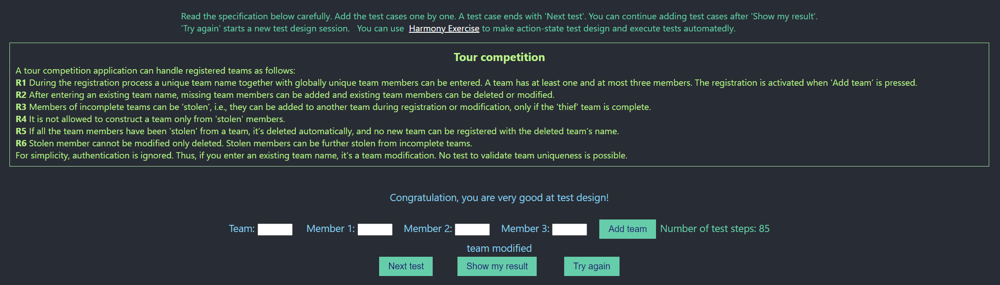

# Execution Report

**Project:** tour-competition  
**Tester:** Alexandr Gusev  
**Execution Period:** October 2026  
**Build Version:** 1.0

---

## Summary

| Metric           | Count |
|------------------|-------|
| Total test cases | 35    |
| Executed         | 35    |
| Pass             | 35    |
| Fail             | 0     |
| Blocked          | 0     |
| Pass rate        | 100%  |

---

## Execution Report

| Case      | Preconditions                                                     | Steps                                        | Expected message                  | Expected result                                                   | Status |
|-----------|-------------------------------------------------------------------|----------------------------------------------|-----------------------------------|-------------------------------------------------------------------|--------|
| TC-R1-001 | "a": {"1", "2", "3"}                                              | "b": {"4", "5", "6"}                         | new team inserted                 | "a": {"1", "2", "3"} "b": {"4", "5", "6"}                      | ✅      |
| TC-R1-002 |                                                                   | "a": {"1", "", ""}                           | new team inserted                 | "a": {"1", "", ""}                                                | ✅      |
| TC-R1-003 |                                                                   | "": {"1", "", ""}                            | Team name cannot be empty         | not created                                                       | ✅      |
| TC-R1-004 | "a": {"1", "2", "3"}                                              | "b": {"1", "4", "5"}                         | all team members should be unique | "a": {"1", "2", "3"}                                              | ✅      |
| TC-R1-005 |                                                                   | "a": {"1", "1", "2"}                         | members should be different       | not created                                                       | ✅      |
| TC-R1-006 |                                                                   | "a": {"1", "2", "2"}                         | members should be different       | not created                                                       | ✅      |
| TC-R1-007 |                                                                   | "": {"", "", ""}                             | At least one member is needed     | not created                                                       | ✅      |
| TC-R2-001 | "a": {"1", "", ""}                                                | "a": {"1", "2", ""}                          | team modified                     | "a": {"1", "2", ""}                                               | ✅      |
| TC-R2-002 | "a": {"1", "2", ""}                                               | "a": {"1", "2", "3"}                         | team modified                     | "a": {"1", "2", "3"}                                              | ✅      |
| TC-R2-003 | "a": {"1", "", ""}                                                | "a": {"1", "2", "3"}                         | team modified                     | "a": {"1", "2", "3"}                                              | ✅      |
| TC-R2-004 | "a": {"1", "", ""}                                                | "a": {"2", "", ""}                           | team modified                     | "a": {"2", "", ""}                                                | ✅      |
| TC-R2-005 | "a": {"1", "2", "3"}                                              | "a": {"4", "5", "6"}                         | team modified                     | "a": {"4", "5", "6"}                                              | ✅      |
| TC-R2-006 | "a": {"1", "2", ""}                                               | "a": {"", "2", ""}                           | team modified                     | "a": {"", "2", ""}                                                | ✅      |
| TC-R2-007 | "a": {"1", "2", "3"}                                              | "a": {"", "", "3"}                           | team modified                     | "a": {"", "", "3"}                                                | ✅      |
| TC-R3-001 | "a": {"1", "2", ""}                                               | "b": {"1", "3", "4"}                         | new team inserted                 | "a": {"", "2", ""} "b": {"1", "3", "4"}                        | ✅      |
| TC-R3-002 | "a": {"1", "2", ""}                                               | "b": {"1", "3", ""}                          | only complete team can stole      | "a": {"1", "2", ""}                                               | ✅      |
| TC-R3-003 | "a": {"1", "2", "3"} "b": {"4", "", ""}                        | "b": {"4", "2", "3"}                         | all team members should be unique | "a": {"1", "2", "3"} "b": {"4", "", ""}                        | ✅      |
| TC-R3-004 | "a": {"1", "2", ""} "b": {"3", "4", "5"}                       | "b": {"2", "4", "6"}                         | team modified                     | "a": {"1", "", ""} "b": {"2", "4", "6"}                        | ✅      |
| TC-R4-001 | "a": {"1", "2", "3"}                                              | "b": {"1", "2", "3"}                         | all team members should be unique | "a": {"1", "2", "3"}                                              | ✅      |
| TC-R4-002 | "a": {"1", "2", ""} "b": {"3", "4", ""} "c": {"5", "6", ""} | "d": {"1", "4", "5"}                         | All members cannot be 'stolen'    | "a": {"1", "2", ""} "b": {"3", "4", ""} "c": {"5", "6", ""} | ✅      |
| TC-R5-001 | "a": {"1", "", ""}                                                | "b": {"1", "2", "3"}                         | new team inserted                 | "a" deleted "b": {"1", "2", "3"}                               | ✅      |
| TC-R5-002 | "a": {"1", "2", ""}                                               | "b": {"1", "2", "3"}                         | new team inserted                 | "a" deleted "b": {"1", "2", "3"}                               | ✅      |
| TC-R5-003 | "a": {"", "2", "3"}                                               | "b": {"1", "2", "3"}                         | new team inserted                 | "a" deleted "b": {"1", "2", "3"}                               | ✅      |
| TC-R5-004 | "a": {"1", "", ""} "b": {"1", "2", "3"}                        | "a": {"4", "5", "6"}                         | deleted team name cannot be used  | "a" deleted "b": {"1", "2", "3"}                               | ✅      |
| TC-R6-001 | "a": {"1", "", ""} "b": {"1", "2", "3"}                        | b: {"4", "2", "3"}                           | Stolen member cannot be modified  | "a" deleted "b": {"1", "2", "3"}                               | ✅      |
| TC-R6-002 | "a": {"1", "2", ""} "b": {"1", "2", "3"}                       | b: {"1", "2", "4"} b: {"5", "2", "4"}     | Stolen member cannot be modified  | "a" deleted b: {"1", "2", "4"}                                 | ✅      |
| TC-R6-003 | "a": {"", "2", "3"} "b": {"1", "2", "3"}                       | b: {"1", "2", "4"}                           | Stolen member cannot be modified  | "a" deleted "b": {"1", "2", "3"}                               | ✅      |
| TC-R6-004 | "a": {"1", "2", "3"} "b": {"4", "5", ""}                       | "a": {"4", "2", "3"} "a": {"6", "2", "3"} | Stolen member cannot be modified  | "a": {"4", "2", "3"} "b": {"", "5", ""}                        | ✅      |
| TC-R6-005 | "a": {"1", "", ""} "b": {"1", "2", "3"}                        | "b": {"", "2", "3"}                          | team modified                     | "a" deleted "b": {"", "2", "3"}                                | ✅      |
| TC-R6-006 | "a": {"", "1", ""} "b": {"1", "2", "3"}                        | "b": {"1", "2", ""} "c": {"3", "1", "4"}  | new team inserted                 | "a" deleted "b": {"1", "2", ""} "c": {"3", "1", "4"}        | ✅      |
| TC-R6-007 | "a": {"1", "", "3"} "b": {"1", "2", "3"}                       | "b": {"1", "2", ""} "b": {"1", "2", "4"}  | new team inserted                 | "a" deleted "b": {"1", "2", ""} "c": {"3", "1", "4"}        | ✅      |
| TC-R6-008 | "a": {"", "2", "3"} "b": {"4", "5", "3"}                       | "a": {"3", "2", ""}                          | all team members should be unique | "a": {"", "2", ""} "b": {"4", "5", "3"}                        | ✅      |
| TC-R6-009 | "a": {"", "2", "3"} "b": {"4", "2", "5"}                       | "a": {"", "6", "3"}                          | team modified                     | "a": {"", "6", "3"} "b": {"4", "2", "5"}                       | ✅      |
| TC-R6-010 | "a": {"1", "2", ""} "b": {"3", "2", "4"}                       | "a": {"1", "5", ""}                          | team modified                     | "a": {"1", "5", ""} "b": {"3", "2", "4"}                       | ✅      |
| TC-R6-011 | "a": {"1", "2", ""} "b": {"1", "2", "3"}                       | "b": {"", "2", "3"} "b": {"4", "2", "3"}  | team modified                     | "a" deleted "b": {"4", "2", "3"}                               | ✅      |

## Result
