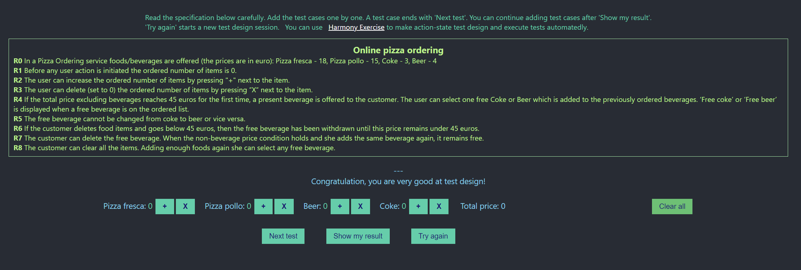

# Execution Report

**Project:** online-pizza-ordering  
**Tester:** Alexandr Gusev  
**Execution Period:** October 2026  
**Build Version:** 1.0

---

## Summary

| Metric           | Count |
|------------------|-------|
| Total test cases | 25    |
| Executed         | 25    |
| Pass             | 25    |
| Fail             | 0     |
| Blocked          | 0     |
| Pass rate        | 100%  |

---

## Execution Report

| Case      | Preconditions                                  | Steps                                                      | Expected result                             | Total price | Status |
|-----------|------------------------------------------------|------------------------------------------------------------|---------------------------------------------|-------------|--------|
| TC-R3-001 |                                                | Add 1 fresca Remove fresca                              | fresca: 0 polo: 0 beer: 0 coke: 0  | 0           | ✅      |
| TC-R3-002 |                                                | Add 1 polo Remove polo                                  | fresca: 0 polo: 0 beer: 0 coke: 0  | 0           | ✅      |
| TC-R3-003 |                                                | Add 1 beer Remove beer                                  | fresca: 0 polo: 0 beer: 0 coke: 0  | 0           | ✅      |
| TC-R3-004 |                                                | Add 1 coke Remove coke                                  | fresca: 0 polo: 0 beer: 0 coke: 0  | 0           | ✅      |
| TC-R4-001 |                                                | Add 3 fresca Choose free beer                           | fresca: 3 polo: 0 beer: 1 coke: 0  | 54          | ✅      |
| TC-R4-002 |                                                | Add 3 polo Choose free coke                             | fresca: 0 polo: 3 beer: 0 coke: 1  | 45          | ✅      |
| TC-R4-003 |                                                | Add 15 coke Nothing to choose                           | fresca: 0 polo: 0 beer: 0 coke: 15 | 45          | ✅      |
| TC-R4-004 |                                                | Add 12 beer Nothing to choose                           | fresca: 0 polo: 0 beer: 15 coke: 0 | 48          | ✅      |
| TC-R4-005 | Add 1 fresca                                   | Add 3 polo Choose free coke Remove fresca            | fresca: 0 polo: 3 beer: 0 coke: 1  | 45          | ✅      |
| TC-R4-006 | Add 3 fresca Add 1 polo Choose free beer | Remove polo                                                | fresca: 3 polo: 0 beer: 1 coke: 0  | 54          | ✅      |
| TC-R4-007 |                                                | Add 1 beer Add 3 polo Choose free beer               | fresca: 0 polo: 3 beer: 2 coke: 0  | 49          | ✅      |
| TC-R4-008 |                                                | Add 1 coke Add 3 fresca Choose free coke             | fresca: 3 polo: 0 beer: 0 coke: 2  | 57          | ✅      |
| TC-R4-009 | Add 3 polo Choose free coke                 | Add 1 polo                                                 | fresca: 4 polo: 0 beer: 0 coke: 1  | 60          | ✅      |
| TC-R4-010 | Add 3 fresca Choose free coke               | Add 1 coke Remove fresca                                | fresca: 0 polo: 0 beer: 0 coke: 1  | 3           | ✅      |
| TC-R4-011 | Add 3 polo Choose free beer                 | Add 1 beer Remove polo                                  | fresca: 0 polo: 0 beer: 1 coke: 0  | 4           | ✅      |
| TC-R6-001 | Add 2 fresca Add 1 polo Choose nothing   | Remove polo Add polo Choose free coke                | fresca: 2 polo: 1 beer: 0 coke: 1  | 51          | ✅      |
| TC-R6-002 | Add 3 fresca Choose free coke               | Remove coke Remove fresca Add 1 coke Add 3 fresca | fresca: 3 polo: 0 beer: 0 coke: 1  | 54          | ✅      |
| TC-R6-003 | Add 3 fresca Choose free coke               | Remove coke Remove fresca Add 3 fresca Add 1 coke | fresca: 3 polo: 0 beer: 0 coke: 1  | 54          | ✅      |
| TC-R6-004 | Add 3 polo Choose free beer                 | Remove beer Remove polo Add 1 beer Add 3 polo     | fresca: 0 polo: 3 beer: 1 coke: 0  | 45          | ✅      |
| TC-R6-005 | Add 3 polo Choose free beer                 | Remove beer Remove polo Add 3 polo Add 1 beer     | fresca: 0 polo: 3 beer: 1 coke: 0  | 45          | ✅      |
| TC-R8-001 | Add 1 coke                                     | Clear all                                                  | fresca: 0 polo: 0 beer: 0 coke: 0  | 0           | ✅      |
| TC-R8-002 | Add 3 polo Choose nothing                   | Clear all                                                  | fresca: 0 polo: 0 beer: 0 coke: 0  | 0           | ✅      |
| TC-R8-003 | Add 3 polo Choose free coke                 | Clear all                                                  | fresca: 0 polo: 0 beer: 0 coke: 0  | 0           | ✅      |
| TC-R8-004 | Add 3 fresca Choose free beer               | Clear all                                                  | fresca: 0 polo: 0 beer: 0 coke: 0  | 0           | ✅      |
| TC-R8-005 | Add 3 fresca Choose free beer               | Clear all Add 3 polo                                    | fresca: 0 polo: 3 beer: 0 coke: 0  | 45          | ✅      |

---

## Result
