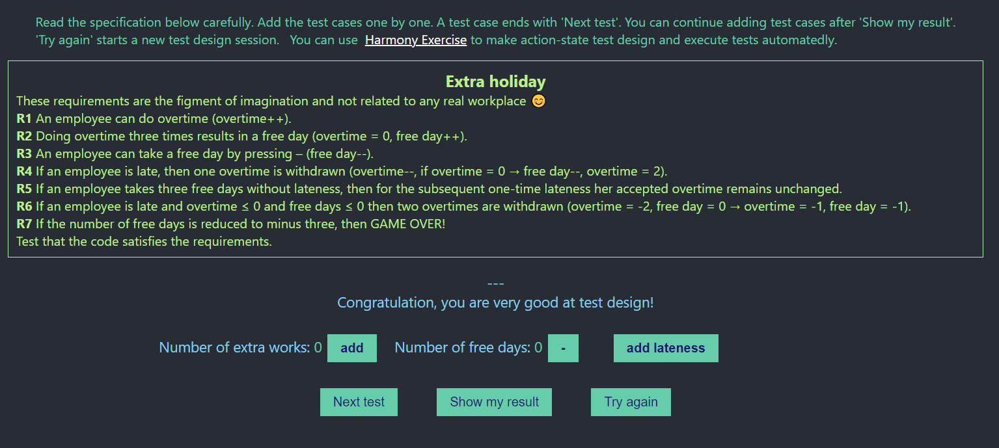

# Execution Report

**Project:** extra-holiday  
**Tester:** Alexandr Gusev  
**Execution Period:** October 2026  
**Build Version:** 1.0

---

## Summary

| Metric           | Count |
|------------------|-------|
| Total test cases | 10    |
| Executed         | 10    |
| Pass             | 10    |
| Fail             | 0     |
| Blocked          | 0     |
| Pass rate        | 100%  |

---

## Execution Report

| Case      | Steps                                                                                                      | Expected result                              | Status |
|-----------|------------------------------------------------------------------------------------------------------------|----------------------------------------------|--------|
| TC-EH-001 | Add 3 extra day Add 1 lateness                                                                          | Extra days: 0 Free days: 0                | ✅      |
| TC-EH-002 | Add 4 extra day Add 1 lateness                                                                          | Extra days: 1 Free days: 0                | ✅      |
| TC-EH-003 | Get 1 free day                                                                                             | Extra days: 0 Free days: 0                | ✅      |
| TC-EH-004 | Add 9 extra day Get 3 free days Add 2 lateness                                                       | Extra days: -2 Free days: 0               | ✅      |
| TC-EH-005 | Add 9 extra day Get 1 free day Add 1 lateness Add 1 extra day Get 2 free day Add 1 lateness | Extra days: 1 Free days: 0                | ✅      |
| TC-EH-006 | Add 1 lateness Add 1 extra day Add 1 lateness                                                        | Extra days: 0 Free days: -1               | ✅      |
| TC-EH-007 | Add 5 lateness                                                                                             | Extra days: -1 Free days: -3 Game Over | ✅      |
| TC-EH-008 | Add 5 lateness Add 1 extra day                                                                          | Extra days: -1 Free days: -3 Game Over | ✅      |
| TC-EH-009 | Add 5 lateness Get 1 free day                                                                           | Extra days: -1 Free days: -3 Game Over | ✅      |
| TC-EH-010 | Add 6 lateness                                                                                             | Extra days: -1 Free days: -3 Game Over | ✅      |

---

## Result
