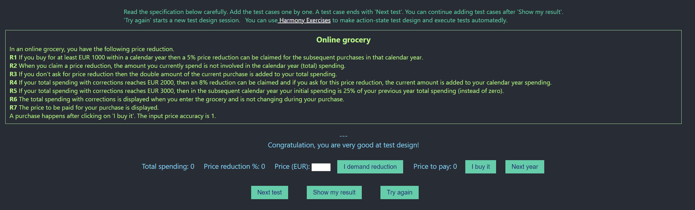

# Execution Report

**Project:** online-grocery   
**Tester:** Alexandr Gusev  
**Execution Period:** October 2026  
**Build Version:** 1.0

---

## Summary

| Metric           | Count |
|------------------|-------|
| Total test cases | 18    |
| Executed         | 18    |
| Pass             | 17    |
| Fail             | 1     |
| Blocked          | 0     |
| Pass rate        | 94%   |

---

## Execution Report

| Case      | Steps                                                                                       | Price to pay | Expected result                 | Status |
|-----------|---------------------------------------------------------------------------------------------|--------------|---------------------------------|--------|
| TC-OG-001 | 1. Price 999 2. Buy it                                                                   | 999          | Discount 0% Total spend 999  | ✅      |
| TC-OG-002 | 1. Price 1000 2. Buy it                                                                  | 1000         | Discount 5% Total spend 1000 | ✅      |
| TC-OG-003 | 1. Price 1001 2. Buy it                                                                  | 1001         | Discount 5% Total spend 1001 | ✅      |
| TC-OG-004 | 1. Price 1000 2. Buy it 3. Next year                                                  | 0            | Discount 0% Total spend 0    | ✅      |
| TC-OG-005 | 1. Price 1000 2. Buy it 3. Price 1000 4. Use discount 5. Buy it                 | 950          | Discount 5% Total spend 1000 | ✅      |
| TC-OG-006 | 1. Price 1000 2. Buy it 3. Price 1000 4. Use discount 5. Buy it 6. Next year | 0            | Discount 0% Total spend 0    | ✅      |
| TC-OG-007 | 1. Price 1000 2. Buy it 3. Price 100 4. Buy it                                     | 100          | Discount 5% Total spend 1200 | ✅      |
| TC-OG-008 | 1. Price 1999 2. Buy it                                                                  | 1999         | Discount 5% Total spend 1999 | ✅      |
| TC-OG-009 | 1. Price 2000 2. Buy it                                                                  | 2000         | Discount 8% Total spend 2000 | ✅      |
| TC-OG-010 | 1. Price 2001 2. Buy it                                                                  | 2001         | Discount 8% Total spend 2001 | ✅      |
| TC-OG-011 | 1. Price 1999 2. Buy it 3. Price 500 4. Use discount 5. Buy it                  | 475          | Discount 8% Total spend 1999 | ✅      |
| TC-OG-012 | 1. Price 2000 2. Buy it 3. Price 1000 4. Use discount 5. Buy it                 | 920          | Discount 8% Total spend 2920 | ✅      |
| TC-OG-013 | 1. Price 2500 2. Buy it 3. Price 100 4. Use discount 5. Buy it                  | 92           | Discount 8% Total spend 2592 | ✅      |
| TC-OG-014 | 1. Price 2999 2. Buy it 3. Next year                                                  | 0            | Discount 0% Total spend 0    | ✅      |
| TC-OG-015 | 1. Price 3000 2. Buy it 3. Next year                                                  | 0            | Discount 0% Total spend 750  | ✅      |
| TC-OG-016 | 1. Price 3500 2. Buy it 3. Next year                                                  | 0            | Discount 0% Total spend 875  | ✅      |
| TC-OG-017 | 1. Price 3000 2. Buy it 3. Next year 4. Price 250 5. Buy it                     | 250          | Discount 5% Total spend 1000 | ✅      |
| TC-OG-018 | 1. Price abc 2. Buy it                                                                   | NaN          | Discount 0% Total spend 0    | ❌      |

---

## Result
